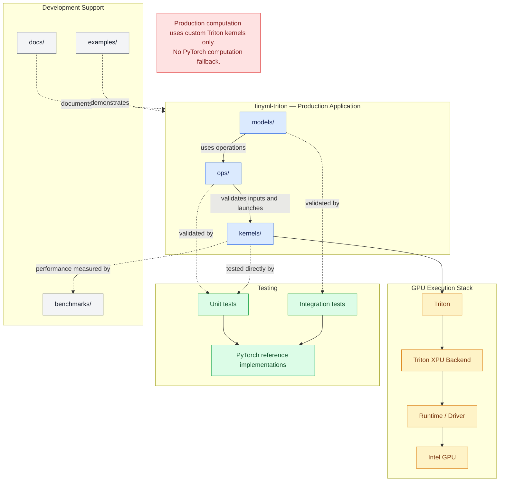
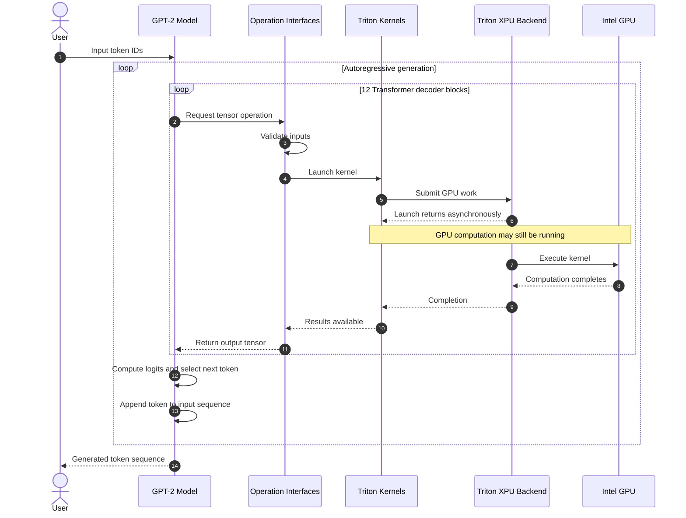

# Project Architecture

## 1. Project Purpose

This is an educational project aimed at learning Triton GPU programming and understanding the fundamental concepts behind Large Language Models (LLMs).

The project will implement the operations required by GPT-2 using custom Triton kernels. These operations will then be assembled into Transformer decoder blocks and eventually into a complete GPT-2 autoregressive language model.

## 2. Design Principles

1. **Operation-first development:** Implement individual tensor operations using Triton kernels, validate them independently, and only then combine them into more complex components.
2. **Custom GPU computation:** All neural-network computations must be performed using our custom Triton kernels.
3. **PyTorch reference:** PyTorch is permitted for tensor management, model orchestration, weight loading, and independent correctness references. It must not be used as a fallback for neural-network computations.
4. **Correctness before performance:** Numerical correctness must be established and validated before optimizing kernel performance.
5. **Incremental development:** Implement, test, document, and commit one operation at a time. Each operation must satisfy its correctness criteria before development proceeds to the next.

## 3. Software Architecture

### 3.1 Application Architecture

The application is divided into three main areas: production code, testing, and development support. The production application is responsible for model execution, while testing and development support remain separate from the production execution path.



**PyTorch boundary:** Production code may use PyTorch tensors for input/output representation, tensor management, model orchestration, and weight loading. PyTorch reference implementations are used for independent correctness validation. PyTorch must not perform neural-network computations as a fallback.

### 3.2 Repository Structure

The repository separates production code, testing, documentation, and development support.

```text
tinyml-triton/
│
├── README.md
├── LICENSE
├── pyproject.toml
├── .gitignore
│
├── docs/
│   ├── ARCHITECTURE.md
│   ├── OPERATIONS.md
│   └── VALIDATION.md
│
├── src/
│   └── tinyml_triton/
│       ├── __init__.py
│       ├── kernels/
│       ├── ops/
│       └── models/
│
├── tests/
│   ├── conftest.py
│   ├── unit/
│   ├── integration/
│   └── reference/
│
├── benchmarks/
│   ├── kernels/
│   └── models/
│
└── examples/
```

#### Production application

- `src/tinyml_triton/kernels/`: Contains the actual Triton GPU kernel implementations.
- `src/tinyml_triton/ops/`: Provides Python interfaces for the operations, handles input validation, and launches the corresponding Triton kernels.
- `src/tinyml_triton/models/`: Contains the model implementations, combining individual operations into Transformer decoder blocks and the complete GPT-2 model.

#### Testing

- `tests/unit/`: Tests individual operations independently, including direct kernel tests and operation interface tests.
- `tests/integration/`: Tests combinations of operations and complete model components.
- `tests/reference/`: Contains independent PyTorch implementations used as correctness references.
- `tests/conftest.py`: Contains shared pytest configuration and fixtures.

#### Development support

- `docs/`: Contains architecture documentation, operation descriptions, and validation procedures.
- `benchmarks/kernels/`: Contains benchmarks for individual GPU kernels.
- `benchmarks/models/`: Contains benchmarks for model components and end-to-end inference.
- `examples/`: Contains example programs demonstrating how to use the implemented operations and models.

### 3.3 Data and Execution Flow

The application follows a layered execution model. Each layer has a specific responsibility, keeping model implementation separate from operation interfaces and low-level GPU computation.



#### Production execution

1. The model receives input token IDs and manages model execution.
2. The model requests the required tensor operations through the `ops/` interfaces.
3. The operation interfaces validate inputs, prepare arguments, and launch the corresponding Triton kernels.
4. The Triton kernels submit GPU work through the Triton XPU backend.
5. GPU execution is asynchronous. A kernel launch may return before the GPU computation has completed.
6. Results become available when the required GPU work has completed. The operation interfaces return the resulting tensors to the model.
7. The model combines the results and continues execution through the Transformer decoder blocks.
8. During autoregressive generation, the model computes logits, selects the next token, appends it to the input sequence, and repeats the process until the generation stopping condition is reached.

#### Correctness validation

Individual operations are validated at two levels:

- **Kernel tests:** Test Triton kernels directly against independent PyTorch reference implementations.
- **Operation tests:** Validate the Python interfaces, input handling, kernel launches, and returned results.

Tests must ensure that GPU computation has completed before comparing numerical results against the references.

Integration tests validate combinations of operations and model components. This ensures that individual operations work correctly together.

PyTorch reference implementations are used exclusively for validation and are never part of the production inference execution path.

#### Performance evaluation

Kernel performance and model inference performance are measured independently using the benchmark suite.

Because GPU execution is asynchronous, benchmarks must account for GPU completion and use appropriate synchronization or device-event timing. Measuring only the time required to launch a kernel does not measure its execution time.

Performance measurements are kept separate from correctness tests.

## 4. Development Workflow

Development follows an operation-first approach. Each tensor operation is implemented, validated, documented, and committed independently before being used in more complex components.

### 4.1 Operation Development Lifecycle

Each operation follows these steps:

1. **Specification:** Define the operation, its mathematical formulation, input/output shapes, data types, and expected behavior.
2. **Implementation:** Implement the GPU computation using a custom Triton kernel.
3. **Interface:** Provide a Python interface in the `ops/` layer to validate inputs and launch the kernel.
4. **Kernel testing:** Test the Triton kernel directly against an independent PyTorch reference.
5. **Operation testing:** Validate the Python interface, argument handling, kernel launch, and returned results.
6. **Edge-case testing:** Validate behavior for different tensor shapes, sizes, and relevant boundary conditions.
7. **Benchmarking:** Measure execution time and evaluate performance, accounting for asynchronous GPU execution.
8. **Documentation:** Record the implementation details, validation results, and benchmark results.
9. **Commit:** Commit the completed operation to version control.

### 4.2 Development Priorities

Development follows these priorities:

1. **Correctness:** Numerical results must satisfy the defined validation criteria.
2. **Reliability:** Operations must handle their supported input shapes and edge cases.
3. **Performance:** Optimize only after correctness has been established.
4. **Maintainability:** Keep implementations, interfaces, tests, and documentation organized and understandable.